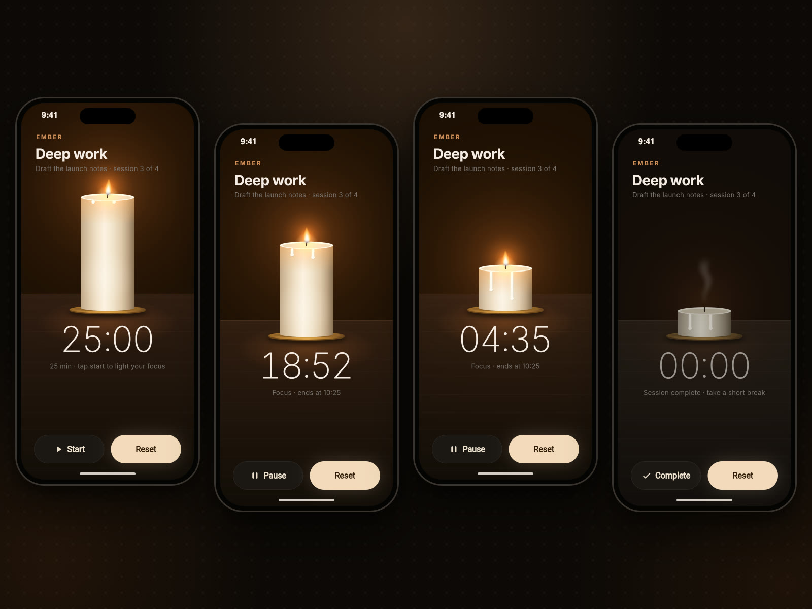

# Candle Focus Timer in Flutter

A calm Pomodoro focus timer built with Flutter. A candle lights itself and melts while you focus, the room glows
in candle light and every digit of the countdown rolls on its own. When the session ends the flame goes out and a
thin line of smoke rises. Tap Reset and the candle grows back and lights up again.

🌐 **Live demo:** https://yaqoobdeveloper.github.io/Candle-Focus-Timer-in-Flutter/

🔒 **Full source code:** available to members of the Flutter Source Club: https://yaqoobdeveloper.com/pro

📺 **YouTube Short:** https://youtube.com/shorts/k9kUnBNxLak

📺 **More Flutter UI:** https://www.youtube.com/@yaqoob_developer

This repository only hosts the live demo. It does not contain the source code.
